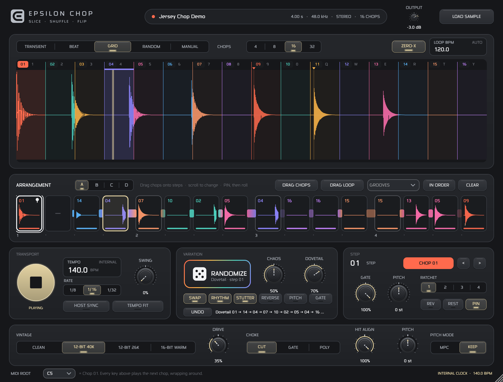

# Epsilon Chop v0.5.0 · User Manual

**Epsilon Sounds · Sample chopper instrument · VST3 / AU / Standalone**

Epsilon Chop cuts a sample into up to 32 **chops** and places them on a 16-step **arrangement**. You can play the arrangement on its own clock or locked to FL Studio, flip it with **RANDOMIZE**, pin a chop and let **Dovetail** build the rest around it, and play any chop from the Piano Roll or your computer keyboard. **Hit Align** keeps every hit in the pocket, **CUT** choke works like FL's "Cut by 1", and the **VINTAGE** section adds classic 12-bit sampler character.

## Contents

1. [Quick start](#1-quick-start)
2. [Header](#2-header)
3. [Chop bar and waveform](#3-chop-bar-and-waveform)
4. [Arrangement](#4-arrangement)
5. [Transport](#5-transport)
6. [Variation (RANDOMIZE)](#6-variation-randomize)
7. [Step inspector](#7-step-inspector)
8. [MIDI and the Piano Roll](#8-midi-and-the-piano-roll)
9. [Sound: Vintage, Choke and Hit Align](#9-sound-vintage-choke-and-hit-align)
10. [Computer keyboard](#10-computer-keyboard)
10b. [Export to FL Studio](#10b-export-to-fl-studio)
10c. [Pitch the whole loop](#10c-pitch-the-whole-loop)
11. [Automation parameters](#11-automation-parameters)
12. [Under the hood](#12-under-the-hood)
13. [Workflows](#13-workflows)
14. [Troubleshooting](#14-troubleshooting)

---

## 1. Quick start

1. Drop a sample anywhere on the window, or click **LOAD SAMPLE**.
2. Leave the mode on **TRANSIENT** for drums and vocals, or pick **GRID → 16** for a clean loop.
3. Click **IN ORDER**, then **PLAY**. You hear the loop rebuilt from its chops.
4. Press **RANDOMIZE**. Chops trade places, and the readout under the button tells you which ones (for example `Swapped 11 ↔ 13`). If PLAY is off, it starts by itself so you hear the flip immediately.
5. If you like the result, keep it, or copy it to bank **B** and keep rolling in **A**. If you don't like it, click **UNDO**.
6. Found one chop you love? Click its step, press **PIN**, and roll again. **Dovetail** picks every other chop so it flows out of the one before it, and the readout shows the chain (for example `Dovetail 01 → 09 → 07 → 06`).
7. Click anywhere in the plugin and play chops from your keyboard: **1–0** are chops 1–10, **Q–P** are 11–20.

---

## 2. Header

| Control | What it does |
| --- | --- |
| **Logo / name** | Identification only. |
| **Sample pill** | Shows the sample name, length, sample rate, mono/stereo and current chop count. While a file loads, it shows *Loading…*, and errors appear here too, such as an unreadable file or one that is too long. |
| **OUTPUT** | Instrument level, from **−24 dB to +6 dB**. The default is **−3 dB**, and double-clicking returns to it. Changes are smoothed over about 8 ms, so turning it never clicks. Automatable. |
| **LOAD SAMPLE** | Opens a file browser. Supported formats are **WAV, AIFF, FLAC, MP3 and OGG**, mono or stereo, at 8–192 kHz, up to **120 seconds** and 8 million frames. You can also drop a file anywhere on the window. The drop area lights up when it will accept the file. Clicking the empty waveform also opens the browser. |

Loading never interrupts audio. Decoding and analysis run on a background thread, and the new sample replaces the old one with a 2 ms crossfade. Loading a new sample clears the undo history and resets LOOP BPM to auto-detect. Your four banks are kept.

---

## 3. Chop bar and waveform

### Chop modes

| Mode | Best for | How it cuts | Context control |
| --- | --- | --- | --- |
| **TRANSIENT** | Drums, vocals, plucks, anything with clear attacks | Cuts just before each detected hit | **SENSITIVITY** (0–100) and **MAX** (8 / 16 / 32 chops) |
| **BEAT** | Loops in time | Cuts on musical divisions of the loop's tempo, nudged onto nearby hits | **DIVISION** (1/4, 1/8, 1/16) |
| **GRID** | Clean loops, pads, quick even chops | Equal-length chops | **CHOPS** (4 / 8 / 16 / 32) |
| **RANDOM** | Happy accidents | Random cut points | **CHOPS** (4 / 8 / 16 / 32) and **RE-CHOP** |
| **MANUAL** | Precise edits | Your own cut points | Edit directly on the waveform |

**SENSITIVITY** sets how strong a hit must be to become a cut. Higher finds quieter attacks. **MAX** caps the count, and when there are more candidates than MAX allows, the strongest hits win. If a sample has no detectable attacks, Transient falls back to an even grid.

**DIVISION** in Beat mode is relative to **LOOP BPM**. 1/8 at 120 BPM gives one chop every 250 ms. If a division would give more than 32 chops, it is doubled until the count fits. Each cut moves onto a nearby hit if there is one, within 20% of a division or 40 ms, whichever is smaller.

**RE-CHOP** rolls new random cut points. Clicking **RANDOM** again while it is already selected does the same thing.

**MANUAL** starts from whatever cuts you were looking at, so you can fine-tune a Transient or Beat result. You can also drag a cut in any automatic mode, which switches to Manual automatically.

### ZERO-X

When on (the default), every automatic cut moves to the nearest **zero crossing** within ±2 ms. That gives click-free chop starts. Your own Manual cuts are never moved. ZERO-X is disabled in Manual mode.

### LOOP BPM

Shows the tempo of the loaded loop. It is estimated from the file length, as explained in [Under the hood](#10-under-the-hood), and the tag reads **AUTO**.

- **Drag up or down** to correct it. The step is 0.1 BPM per pixel, and holding **Shift** gives fine steps.
- **Scroll** to change it by ±1 BPM.
- **Double-click** to return to the detected value.
- The tag reads **SET** when you have overridden it.

LOOP BPM is used by **BEAT** mode and by **TEMPO FIT**.

### The waveform

Every chop has its own colour: ember, lagoon, saffron, iris, rose, sky, peach and orchid, repeating every eight chops. The same colour marks that chop everywhere in the plug-in.

| Action | Result |
| --- | --- |
| **Click a chop** | Plays it (audition) and selects it. The selected chop is brighter and its number tag fills in. The selected chop is used whenever you turn a rest into a hit. |
| **Drag a chop** out of the waveform | Picks it up as a coloured tag. Drop it on any step in the arrangement. |
| **Hover a cut line** | The cursor changes to a resize arrow. |
| **Drag a cut line** | Moves the cut. Chops keep at least 4 ms of length. In an automatic mode this switches to Manual. |
| **Double-click** empty waveform | Adds a cut (up to 32 chops). |
| **Right-click a cut line** | Removes it. |

Live indicators:

- A **volt-coloured playhead** shows exactly where in the sample the current chop is reading.
- The chop that is sounding gets a coloured bar across its top.

---

## 4. Arrangement

The arrangement is **16 steps**. Each step is either a **rest** or a **hit**. A hit carries a chop, gate, ratchet, pitch and reverse. Steps are grouped in fours, with the beat numbers 1–4 underneath.

### Reading a step cell

- **Number (top-left)**: the chop it plays, in that chop's colour.
- **Waveform**: the actual audio of that chop.
  - It is drawn **once per ratchet**, so ×3 shows three copies.
  - It is **mirrored** when reversed.
  - It is **faded** past the gate point, so you can see what is cut off.
- **Badges (top-right)**: pitch in semitones (for example `+7`), and a ◀ arrow when reversed.
- **Bar (bottom)**: the gate length.
- **White outline**: the selected step, which the Step panel edits.
- **Volt outline**: the step playing right now.

### Mouse

| Action | Result |
| --- | --- |
| **Click** | Selects the step and auditions its chop. |
| **Right-click** or **Shift-click** | Toggles rest ↔ hit. A new hit uses the selected chop. |
| **Double-click** | Toggles rest ↔ hit. |
| **Scroll wheel** over a step | Steps through chops and auditions each one. |
| **Drop a chop** from the waveform | Assigns that chop to the step and keeps the step's gate, ratchet, pitch and reverse. |

### Header controls

| Control | What it does |
| --- | --- |
| **A / B / C / D** | Four independent banks, each with its own 16 steps. The sample and cuts are shared. Switching banks is instant and is not an undo step. |
| **GROOVES** | Replaces the current bank with a starting rhythm: *Straight Eighths*, *Jersey Bounce*, *Drill Space* (with a triplet ratchet) or *Dembow Pocket*. |
| **IN ORDER** | Lays the chops out in their original order across the 16 steps, spaced evenly (8 chops land on every other step). With the right RATE and LOOP BPM, this plays the sample back as recorded. It's the best starting point for flipping a loop. Only the first 16 chops fit. |
| **CLEAR** | Turns every step in the current bank into a rest. |

---

## 5. Transport

| Control | What it does |
| --- | --- |
| **PLAY** (big round button) | Starts and stops the arrangement on Epsilon Chop's **internal clock**. FL Studio does not need to be playing. It always starts from step 1. When lit, it shows a stop square, and the label underneath reads **PLAYING** (internal), **HOST** (locked to FL) or **PREVIEW** (stopped). |
| **TEMPO** | Clock speed, 40–240 BPM. When FL reports its tempo, which it always does, the box follows FL and is tagged **HOST**. Otherwise the tag reads **INTERNAL**, and you can drag it (0.2 BPM per pixel, Shift for fine), scroll it, or double-click for 120. Automatable as *Internal Tempo*. |
| **RATE** | Length of one step: **1/8**, **1/16** (default) or **1/32**. Sixteen steps then span 2 bars, 1 bar or ½ bar of 4/4. Automatable. |
| **SWING** | 0–60%. Delays every second step: the first step of each pair gets longer and the second gets shorter, so the pair keeps its total length. At 33% the off-steps land on a triplet feel. Double-click for 0. Automatable. |
| **HOST SYNC** | When on, the bank plays whenever **FL's transport** is running, locked to FL's bar position: step 1 always falls on the bar line. When FL stops, the pattern stops. If PLAY is also on, host sync takes over while FL runs. Automatable as *Host Sync* (the same parameter v0.1.0 called *Pattern*). |
| **TEMPO FIT** | Repitches the whole sample so its **LOOP BPM** matches the current tempo. For example, a 90 BPM loop in a 120 BPM project plays 33% faster and higher. This keeps chops on the grid. It works like a turntable or Slicex without stretching, so pitch moves with speed. The speed factor is limited to ¼× – 4×. Automatable. |

---

## 6. Variation (RANDOMIZE)

**RANDOMIZE** rewrites the current bank. The toggles under it choose *what* may change, and **CHAOS** chooses *how much*. Every roll is one undo step. If the transport is stopped, RANDOMIZE also starts PLAY so you hear the result straight away. The subtitle on the button lists the active toggles.

### CHAOS (0–100%)

Sets how big each roll is. 0% makes the smallest possible change, which acts like 5%; 100% rewrites everything the active toggles allow. The default is 50%.

### The six toggles

| Toggle | What changes | How much CHAOS matters |
| --- | --- | --- |
| **SWAP** | **Chops trade places.** A swap of 11 and 13 turns every hit of chop 11 into 13 and every 13 into 11. Timing, gates, ratchets, pitch and reverse are untouched. The partner can be any chop in the sample, including ones that aren't in the bank yet, so swaps also bring new parts of the sample in. The readout under the button lists every swap, for example `Swapped 11 ↔ 13   04 ↔ 07`. | Number of swaps = CHAOS × (number of different chops in the bank) ÷ 2, at least one. At **95% and above**, every chop is **shuffled at once**, and each chop still appears exactly as often as before. |
| **RHYTHM** | Moves hits to different steps. Downbeats are preferred: step 1 is most likely, then 9, 5 and 13, then the in-between eighths, then the sixteenths, so random rhythms still groove. Sometimes it adds or drops a hit, keeping between 4 and 13 hits and never removing step 1. | Moves CHAOS × hits hits (at least one). The chance of adding or dropping a hit is CHAOS × 60%. |
| **STUTTER** | Gives hits **ratchets**: 2, 3 or 4 fast repeats inside the step (2 is the most common). | Each hit has a CHAOS × 32% chance. Other hits are reset to a single trigger. |
| **REVERSE** | Plays some chops backwards. | Each hit has a CHAOS × 30% chance. Other hits are set to forward. |
| **PITCH** | Shifts some hits by musical intervals: −12, −7, −5, +5, +7 or +12 semitones. | Each hit has a CHAOS × 30% chance. Other hits are reset to 0. |
| **GATE** | Changes hit lengths to 25, 40, 60, 80 or 100%. | Each hit has a CHAOS chance. |

Notes:

- **CHAOS is the chance that each hit is re-rolled at all** for STUTTER, REVERSE, PITCH and GATE (v0.3). At low CHAOS most of what you set by hand stays; at 100% every hit is re-rolled. Turn a toggle off to keep the values completely.
- Swaps never share a chop (v0.3), so the readout is exactly what happened: `11 ↔ 13   04 ↔ 07` means those two pairs traded places, nothing else.
- If the bank is empty, RANDOMIZE writes a new 5–9 hit phrase.
- If a roll happens to change nothing, one swap is forced, so the button always does something.
- The random sequence is seeded and saved with your project. Undoing and rolling again from the same point gives a new result.

### DOVETAIL (pin a step, then roll)

Dovetail is the "perfect fit" mode. **PIN** a step (in the STEP panel) and press **RANDOMIZE**: the pinned step never changes, and every other hit gets the chop that best *continues* the one before it, all the way round the bar and back into the pinned step, so the loop point fits too.

How "fit" is judged, for every possible join of chop A into chop B:

- **Key.** The notes at the end of A against the notes at the start of B (a 12-note pitch-class profile), and B against the pinned chop, so the whole flip stays in one key.
- **Loudness.** How much the level jumps at the join.
- **Tone.** How much brighter or darker B starts than A ends.
- **As played.** Each step is scored the way it actually sounds: a reversed step swaps its start and end, and a pitched step is transposed.
- **Learned from your sample.** Every term is compared with the joins your recording already makes (chop 1 into 2, 2 into 3 …), so "fits" means "flows the way this sample flows". The sample's own next chop always counts as a good fit; a chop straight into itself counts as a stutter, not a flip.

The **DOVETAIL** knob sets how strict the fit is (0% = off, plain RANDOMIZE). **CHAOS** sets how adventurous it is: at low CHAOS you get the best-fitting chain almost every time, at high CHAOS it explores looser fits. The whole chain is chosen at once, so it never paints itself into a corner by step 6.

On the arrangement, the pinned step has a white **keystone** border and a pin. Every join shows how well it fits: neighbouring cells lock together with a bridge that glows brighter the better the fit, and a join across rests shows a notch on the incoming cell. RHYTHM, STUTTER and the other toggles still work with a pin; they just never touch the pinned step. PIN is per bank.

### UNDO

Steps back through the last **32** edits. **Undo is per bank** (v0.3): a roll or step edit in bank A is only undone while you're in bank A, so switching banks never makes UNDO change a pattern you're not looking at. Chop-layout edits (mode, cuts, LOOP BPM) can be undone from any bank. The undoable edits are:

- chop mode and cut changes
- grooves, IN ORDER and CLEAR
- step edits
- rolls

It does **not** undo bank switching, the randomizer toggles, CHAOS, DOVETAIL or PIN, because those are settings rather than content. Loading a new sample clears the history.

---

## 7. Step inspector

Edits the **selected step**: the one with the white outline.

| Control | What it does |
| --- | --- |
| **Step number** | Which step you are editing (01–16). |
| **Chop chip** | The chop this step plays, in its colour, or **REST**. |
| **< / >** | Previous or next chop, wrapping around. Each press auditions the new chop. On a rest, it creates a hit with the selected chop. |
| **GATE** | 10–100% of the step length. The hit is cut off with a 2 ms fade after this time. A chop shorter than the gate simply ends naturally. With ratchets, the gate applies to each repeat. |
| **PITCH** | −12 to +12 semitones, by resampling, so up is shorter and brighter and down is longer and darker. Double-click for 0. |
| **RATCHET** | 1–4 equal repeats inside the step. Repeats after the first play at 82% level, so they sit behind the main hit. |
| **REV** | Plays the chop from its end back to its start. |
| **REST** | Toggles the step between a rest and a hit. A new hit uses the selected chop. |
| **PIN** | Pins this step for Dovetail: RANDOMIZE never changes it and builds the bank around it. Click again to unpin. Only a hit can be pinned. |

Knob drags are recorded as one undo step per drag.

---

## 8. MIDI and the Piano Roll

- **MIDI ROOT** (footer) sets which note plays **Chop 01**. The range is C1–C7 (MIDI 24–96) and the default is **C5** (MIDI 60). That is the note FL Studio's Channel Rack step sequencer plays, so a new channel makes sound straight away.
- Each key up plays the next chop, and the map **wraps**. With 8 chops, C5–G5 play chops 1–8, G#5 plays chop 1 again, and B4 plays chop 8. Every key plays something.
- **Velocity** sets the hit level.
- MIDI hits play the chop plainly. Step pitch, reverse, ratchet and gate belong to the arrangement only.
- How a note ends depends on **CHOKE** (section 9). In **CUT** and **POLY** a note plays the chop to its end or until a hit cuts it, like a pad. In **GATE**, releasing the key ends the chop, so Piano Roll note lengths count.
- With **HIT ALIGN** on, a note starts the chop right at its attack, so a chop with a few ms of lead-in still sounds exactly on the note.
- **All Notes Off** (CC 120/123) silences MIDI hits.
- Note names follow FL Studio, where middle C is C5.

---

## 9. Sound: Vintage, Choke and Hit Align

The bottom panel.

### VINTAGE and DRIVE

The character of classic hardware samplers, applied to everything Epsilon Chop plays.

| Mode | Sound |
| --- | --- |
| **CLEAN** | Off. Exactly the sample. |
| **12-BIT 40K** | Punchy and warm, in the spirit of the late-'80s drum samplers: 40 kHz, 12-bit converter, a soft reconstruction filter and extra low-end weight. |
| **12-BIT 26K** | Gritty, in the spirit of the classic 26 kHz 12-bit beat machine: no anti-alias filter, so high frequencies fold back as grit. |
| **16-BIT WARM** | Clean but rounded, in the spirit of the early-'90s 16-bit samplers: 44.1 kHz, 16-bit, gentle top-end roll-off and a little low-end. |

**DRIVE** sets how hard the sound hits the analogue input stage before the converter: low settings add weight, high settings saturate and compress.

Under the hood: soft saturation (input stage) → sample-and-hold at the machine's rate → quantising to 12 or 16 bits → low shelf at 90 Hz → two-stage low-pass (output stage). It runs on the mixed output, so it costs the same however many hits are playing.

### CHOKE

| Mode | Behaviour |
| --- | --- |
| **CUT** (default) | Like setting every pad to **"Cut by 1"** in FL Studio: each hit cuts the last one and rings until the next, so every hit flows into the next with no gaps. A step at 100% gate rings past the end of its step; a lower gate still shortens it. |
| **GATE** | v0.2 behaviour: each hit stops at its step gate, and MIDI and keyboard notes stop when you let go. |
| **POLY** | Hits ring over each other. A chop only cuts itself. |

Every cut uses a 2 ms fade, so nothing clicks.

### HIT ALIGN

Most cuts don't land exactly on the hit: there's often a few ms of lead-in (a breath, a pickup, room noise, the zero-crossing snap) before the attack. When chops trade places, those different delays make a flip sound slightly drunk even though every step starts on the grid.

Hit Align measures each chop's **hit point** (how many ms after its cut the attack really starts; you'll see a small marker on the waveform and a tick in each step cell) and **starts the chop that much early**, so every attack lands exactly on the grid whatever chop goes where. The sequencer knows when every step is coming, so it can do this without adding any latency. MIDI and keyboard hits can't start before you play them, so they start right at the attack instead.

100% fully compensates (within a fraction of a millisecond). Lower it to keep some of the natural looseness. 0% is v0.2 timing. Compensation is at most 60 ms, and reversed steps play as cut.

---

## 10. Computer keyboard

Click anywhere in the plugin window to give it the keyboard, then:

- **1, 2 … 9, 0** play chops **01–10**.
- **Q, W … O, P** play chops **11–20**.

The key letter is shown next to each chop number on the waveform. Keys follow CHOKE (in GATE mode, letting go ends the chop) and HIT ALIGN. Holding a key doesn't retrigger. If FL Studio grabs the keys instead, click the plugin window again, or turn off FL's *Typing keyboard to piano roll* while you play.

---

## 10c. Pitch the whole loop

**PITCH** (bottom row) pitches everything Chop plays: the pattern, MIDI notes, the computer keyboard and DRAG LOOP. It goes two octaves either way (-24 to +24 semitones) and adds to each step's own PITCH. Double-click it to go back to 0. It's automatable in FL (*Pitch*), so you can sweep a loop down into a drop.

**PITCH MODE** sets how it sounds:

| Mode | What happens | Use it for |
|---|---|---|
| **MPC** | The classic sampler way: a chop pitched down also plays slower, so it gets darker and heavier, like turning down the pitch on an MPC or SP. Every chop still starts exactly on its step. | Soul and boom-bap flips, slowed-down drill/trap melodies, chopped vocals with that "pitched" sound |
| **KEEP** (keep length) | Only the pitch moves; every chop keeps its length and timing. Done with short overlapping grains, aligned so they don't phase. | Putting a sample in the key of your beat without changing its feel |

Tips:
- Changing key: one semitone per step on the knob. To move a sample from A minor to G minor, set **-2 st**.
- In MPC mode a pitched-down chop can ring into the next one; with CHOKE on CUT the next hit cuts it cleanly.
- Big KEEP shifts (more than about an octave) start to sound grainy; that's the trade-off for keeping the length. MPC mode stays clean at any setting.

---

## 10b. Export to FL Studio

Three ways to get audio out of Chop and into FL Studio (or any DAW). All of them are plain drags.

| Drag | You get | Drop it on |
|---|---|---|
| **A chop** from the waveform, past the edge of the plugin window | That one chop as a WAV | Playlist (an audio clip), Channel Rack (a sampler channel), or a Slicex/FPC pad |
| **DRAG CHOPS** (arrangement bar) | Every chop, numbered *Chop 01, Chop 02 …* | Channel Rack: FL makes one channel per chop, ready for the step sequencer |
| **DRAG LOOP** (arrangement bar) | This bank (A–D) as one audio loop, exactly as you hear it | Playlist: it lines up with the bar and loops seamlessly |

**What's in each file**

- Chops are the raw audio between the cuts, at the sample's own rate, 24-bit, with tiny click guards (0.3 ms in, 2 ms out). Vintage and Drive are not printed, so you can process them in FL.
- The loop is printed with everything: swing, choke, ratchets, pitch, reverse, Hit Align, Vintage, Drive and Output. It's rendered at the project tempo (the host's tempo once FL has played, otherwise the TEMPO box) and is exactly one pattern long (one bar at 1/16). The loop is rendered twice and the second pass kept, so tails that ring over the loop point are already in the file and the clip loops without a gap or click.

**Where the files go**

`Music/Epsilon Sounds/Epsilon Chop/<sample name>/`. FL links to dragged-in audio by its location, so the files are kept there, never in a temp folder that macOS clears. Dragging the same thing again reuses the same file; if the audio changed, the new file gets a new name (*… (2).wav*), so audio already used in a project is never overwritten. Click DRAG CHOPS or DRAG LOOP without dragging to open the folder in Finder, which is handy for FL's Browser.

**Tips**

- Flip a sample into a beat: RANDOMIZE until it bounces, DRAG LOOP to the Playlist, then try more rolls on bank B and drag those too. Every take gets its own file.
- Want chops to sit on FL's grid? Use GRID or BEAT mode, then DRAG CHOPS onto the Channel Rack and program them in the step sequencer.

---

## 11. Automation parameters

| Parameter | Range | Default |
| --- | --- | --- |
| Host Sync | Off / On | Off |
| Output | −24 … +6 dB | −3 dB |
| Step Rate | 1/8, 1/16, 1/32 | 1/16 |
| Swing | 0 … 60 % | 0 % |
| Tempo Fit | Off / On | Off |
| Root Note | 24 … 96 | 60 (C5) |
| Internal Tempo | 40 … 240 BPM | 120 |
| Choke | Cut, Gate, Poly | Cut |
| Hit Align | 0 … 100 % | 100 % |
| Vintage | Clean, 12-bit 40k, 12-bit 26k, 16-bit Warm | Clean |
| Drive | 0 … 100 % | 35 % |

Projects saved with v0.1 or v0.2 open with Choke = Gate, Hit Align = 0 and Vintage = Clean, so they sound exactly as before.

Chop settings, patterns and randomizer settings are saved with the project, but they are not automatable.

---

## 12. Under the hood

### Loading and analysis (background thread)

1. **Decode.** The file is read in 64k-frame blocks at its own sample rate. Non-finite values are zeroed and values are limited to ±8.
2. **Overview.** A 2,048-column min/max overview is built for drawing.
3. **Onset detection** uses spectral flux with a frequency maximum filter (Böck and Widmer, DAFx 2013):
   - **Spectrum:** Hann window at least 16 ms long (a power-of-two FFT), hopping a quarter window. The log magnitude of each channel is taken, keeping the louder channel per bin, so opposite-polarity stereo can't cancel a hit.
   - **Novelty:** the positive change of each bin against the *maximum of its three neighbouring bins* in the previous frame. This ignores vibrato and slides.
   - **Peak picking:** a frame is a candidate when it is a local maximum and exceeds 1.25 × the mean of the surrounding ±10 frames plus a small floor.
   - **Attack refinement:** each candidate is moved to where the waveform first reaches 15% of its local peak, then 1 ms earlier, so the chop includes the very start of the attack.
   - **Limits:** candidates closer than 35 ms to a stronger one, or within 10 ms of either end of the file, are dropped. Up to 256 are kept *with their strengths*.
4. **Loop tempo.** The length is assumed to be a power-of-two number of 4/4 beats (1, 2, 4 … 256). The estimate is the one that lands in **80–160 BPM**. A 4-second file reads as 120 BPM (8 beats), and an 8-beat loop at 92 BPM reads as 92.

### How each mode picks cuts (instant, no re-analysis)

- **Transient:** keeps onsets with strength ≥ strongest × (0.6 × (1 − sensitivity/100)² + 0.004). If more than MAX − 1 remain, the strongest win. This is why the SENSITIVITY slider responds instantly.
- **Beat:** described in [Chop modes](#chop-modes).
- **Random:** a seeded generator places cuts with a minimum spacing of the length ÷ (4 × count).
- In every automatic mode, chops are at least min(25 ms, length/64) long. ZERO-X then snaps each cut to a sign change in the mono sum within ±2 ms.

### Clock

- **Host sync:** step position = FL's quarter-note position × steps per quarter. 16 steps loop from FL's bar 1. If FL jumps (a loop, a click in the timeline, a tempo change), the clock re-anchors without firing a stray hit.
- **Internal clock:** starts at step 1 when you press PLAY, and runs at FL's tempo if FL reports one, otherwise at TEMPO.
- **Timing accuracy:** every step and every ratchet is timed to the exact sample inside the audio block. Output is identical at any buffer size, which is tested at 64, 257 and 1,024 frames.
- **Swing:** warps the step grid in pairs, as described under SWING.

### Voices and sound

- **Voices:** a pool of 16 voices. In CUT and GATE each hit fades the last one out over 2 ms; in POLY they overlap.
- **Fades:** a 0.3 ms fade-in, so attacks stay sharp, and a 2 ms fade-out at the end, the gate and every choke.
- **Cuts and attacks.** ZERO-X now only moves a cut *backwards* (up to 2 ms) onto a zero crossing, so a cut placed on an attack never lands after it. Hit Align then measures the attack with a 0.5 ms peak envelope over the first 30 ms of each chop: the attack is the block with the biggest jump over what came before it.
- **Look-ahead.** The sequencer looks up to 60 ms (never more than half the shortest step) ahead, so a chop with lead-in can start early and its hit lands on the grid.
- **Resampling.** A 32-tap Blackman-windowed sinc interpolator with 64 sub-sample phases handles three cases:
  - a sample rate that differs from FL's
  - step pitch
  - TEMPO FIT

  When reading faster than 1×, it switches to one of 81 lower-cutoff filters to prevent aliasing. When nothing needs resampling, samples are read directly with no filtering at all.
- **Reverse:** reads from the chop's last sample backwards with the same interpolator.
- Output level is smoothed over about 8 ms.

### Real-time safety and CPU

- **Audio thread:** the audio thread never allocates memory, locks, or touches files. Every edit builds a new immutable copy of the session, which is published atomically. The audio thread holds a *hazard pointer* to the copy it's using, so a copy is only freed after the audio thread has stopped using it.
- **Editor cost:**
  - The editor polls at 30 Hz.
  - The waveform and arrangement are rendered once into cached images at the screen's pixel density, and are redrawn only when something changes.
  - During playback, only the playhead and the active step outline are drawn over the cached images.

  A full redraw of the whole window costs about 5 ms in software, but that happens only when content changes.
- **Optimisation:** Debug and Release are both built with -O3, so Xcode's Build/Run never gives you a slow plug-in. A debug build that isn't optimised says *SLOW UNOPTIMISED BUILD* in the footer.

### What is saved in your FL project

The project stores:

- the decoded sample, so the project opens even if the file has moved
- the chop mode and its settings
- manual cuts
- all four banks
- the randomizer settings and seed
- every parameter

Since v0.3 the sample is stored as **24-bit FLAC** (scaled so nothing clips), together with its analysed hits, so projects are roughly half the size or less and reopen without re-analysing. PINs and the DOVETAIL amount are saved too. Saved data ends with a check marker, and damaged data is ignored instead of loading garbage. Sessions from v0.1 and v0.2 still open.

---

## 13. Workflows

**Flip a loop, keep the groove**

1. Choose **GRID → 16** (or **BEAT → 1/16**), then **IN ORDER**.
2. Turn on **TEMPO FIT** if the loop's tempo differs from the project.
3. Leave only **SWAP** on and set CHAOS to about 20–35%.
4. Roll until a swap catches your ear. The readout tells you what moved, so you can rebuild it by hand later.
5. Save winners to banks B–D.

**Chop a drum break**

1. Use **TRANSIENT** with SENSITIVITY around 60–75 and **MAX 16**.
2. Use **SWAP + RHYTHM + STUTTER** at 50%.
3. Set **RATE 1/16** and **SWING** between 15 and 25%.

**Vocal chops**

1. Use **TRANSIENT** at low sensitivity to catch syllables, or **RANDOM → 8**.
2. Use **SWAP + PITCH + REVERSE** at 40%.
3. Shorten the gates for stabs.

**Build a flip around one chop (Dovetail)**

1. Chop the sample, click **IN ORDER**, press **PLAY**.
2. Click the step with the chop you love and press **PIN**.
3. Set **DOVETAIL** to 70–100% and **CHAOS** low (10–30%) for smooth, in-key flips; raise CHAOS for wilder ones.
4. Leave **SWAP** or **RHYTHM** on and roll. Each roll keeps the pinned chop and fits everything else around it.

**Dusty MPC-style drums**

1. **TRANSIENT** chops, **CHOKE: CUT**, **HIT ALIGN** 100%.
2. **VINTAGE: 12-BIT 40K** with DRIVE around 40%, or **12-BIT 26K** for grit.
3. **SWING** 15–25% at 1/16.

**Play it yourself**

1. Turn HOST SYNC off.
2. Click **IN ORDER** to see which chop is which.
3. Click the plugin and finger-drum on **1–0 / Q–P**, or play from C5 upward in the Piano Roll. Every key plays a chop.

---

## 14. Troubleshooting

| Symptom | Fix |
| --- | --- |
| **No sound** | Press **PLAY**, or turn on **HOST SYNC** and start FL. Check that the bank isn't all rests. For MIDI, any key plays something. Check the mixer track and OUTPUT. |
| **Sound cuts out when FL is stopped** | FL's *Smart disable* can put idle generators to sleep. Turn it off for this channel in the plugin wrapper's options menu (the ▼ at its top-left) → *Smart disable*. |
| **Everything sounds sped up or chipmunked** | TEMPO FIT is on and LOOP BPM is wrong. Drag LOOP BPM to the loop's real tempo, often double or half the detected value. |
| **Clicks at chop starts** | Turn **ZERO-X** on. In Manual, nudge the cut onto a quiet point. |
| **Number keys don't play chops** | Click inside the plugin window first. If FL still takes the keys, turn off *Typing keyboard to piano roll* in FL. |
| **Hits ring into each other** | That's **CHOKE: CUT** with a 100% gate. Lower the step gate, or switch CHOKE to **GATE**. |
| **The flip sounds early or late** | Check HIT ALIGN is at 100%. If a chop's hit marker is in the wrong place, nudge the cut in Manual so the attack is near the start. |
| **Beat chops are in the wrong places** | Fix **LOOP BPM** first. Beat mode divides by it. |
| **Pattern starts mid-bar with HOST SYNC** | That's expected: the pattern follows FL's position. Step 1 is always on the bar line. |
| **macOS says the plug-in is damaged** (CI downloads) | Run the `xattr -dr com.apple.quarantine` commands in `INSTALL.txt`. |
