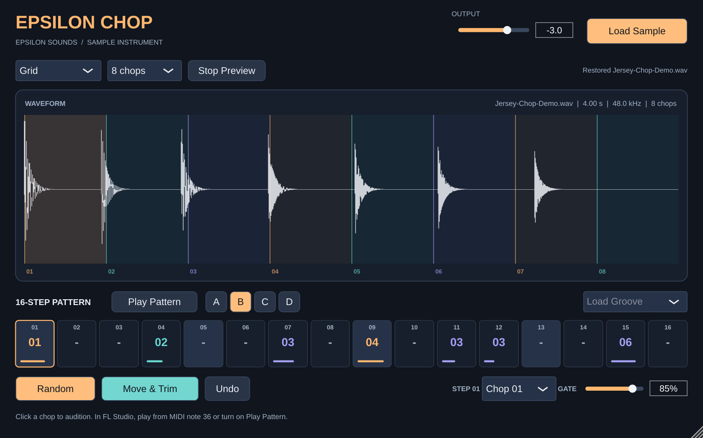

# Epsilon Chop

**Epsilon Sounds · v0.5.0 · sample chopper instrument (VST3 · AU · Standalone)**

**Pin the chop you love. Epsilon Chop builds the rest around it.**

Drop in a sample. Epsilon Chop cuts it into colour-coded chops, lays them on a 16-step ribbon and flips them with one roll of the dice. Pin one chop and **Dovetail** picks every other chop so it flows out of the one before it: same key, smooth level, matching tone, all the way round the bar. **Hit Align** lands every hit exactly on the grid whatever chop goes where, **CUT** choke works like FL Studio's "Cut by 1" on every pad, and **VINTAGE** adds the punch and grit of classic 12-bit samplers. Finger-drum chops straight from your computer keyboard.



[Download the v0.3.0 Projucer project (JUCE 9.0.5 included)](Epsilon-Chop-v0.3.0-Projucer.zip)

## iPhone app

The same Chop, as a standalone iPhone app with a touch layout: **LOAD** a sample from Files, voice memos or AirDrop (WAV, AIFF, MP3, M4A), see the colour-coded chops, then four pages:

- **PADS**: 4 x 4 finger-drum pads (pad 1 bottom left, like an MPC), several at once; 17-32 on a second bank
- **PATTERN**: the 16 steps, tap one and pick its chop with < >, REST, REV, PIN for Dovetail, CHAOS, DOVETAIL, SWING, banks A-D, IN ORDER, CLEAR, UNDO
- **SOUND**: PITCH with MPC / KEEP LENGTH, VINTAGE, DRIVE, OUTPUT, CHOKE, HIT ALIGN
- **EXPORT**: share the loop (1, 2, 4 or 8 passes), every chop, or one chop through the share sheet (AirDrop, Messages, FL Studio Mobile...). Everything is also kept in *Files > On My iPhone > Epsilon Chop*.

**Put it on your iPhone** (needs Xcode; a free Apple ID works for your own phone):

1. Open `Epsilon-Chop.jucer` in Projucer, pick the **Xcode (iOS)** exporter, *Save and Open in IDE*.
2. In Xcode: click the project, target **Epsilon Chop - Standalone Plugin** > *Signing & Capabilities* > tick *Automatically manage signing* and choose your Apple ID as the Team (Xcode > Settings > Accounts to add it). If Xcode says the bundle ID is taken, change `com.epsilonsounds.chop` to something of your own.
3. Plug in the iPhone, choose it at the top of Xcode, press Run.
4. On the iPhone the first time: *Settings > Privacy & Security > Developer Mode* on, and *Settings > General > VPN & Device Management* > trust your Apple ID.

With a free Apple ID the app runs for 7 days, then press Run again. The Apple Developer Program ($99/year) removes that limit and allows TestFlight and the App Store. JUCE is AGPLv3 or commercial: selling a closed-source app on the App Store needs a commercial JUCE licence.

GitHub builds it for iPhone and the iPhone simulator on every push, launches it in the simulator and checks it keeps running.

## New in v0.5.0: pitch the whole loop

**PITCH** (bottom row, -24 to +24 st) pitches everything Chop plays, including MIDI, the computer keyboard and DRAG LOOP, on top of each step's own pitch. **PITCH MODE**: **MPC** pitches the classic sampler way (down = slower, darker, heavier; every chop still starts on its step), **KEEP** changes only the pitch so each chop keeps its length. Both are automatable. [Manual](MANUAL.md#10c-pitch-the-whole-loop).

## New in v0.4.0: export to FL Studio

| Drag | You get |
| --- | --- |
| **A chop** from the waveform, past the plugin's edge | That chop as a WAV: drop it on FL's Playlist, Channel Rack, or a Slicex/FPC pad |
| **DRAG CHOPS** | Every chop, numbered: drop on the Channel Rack for one channel per chop |
| **DRAG LOOP** | This bank as one seamless audio loop, exactly as you hear it, at the project tempo: drop it on the Playlist |

Files are kept in *Music/Epsilon Sounds/Epsilon Chop/&lt;sample&gt;/* (not a temp folder) so FL projects keep finding them, and an export never overwrites audio a project already uses. Also new: the Epsilon Dial house typeface, the Hallmark product mark and the Chop app icon. Details in [the manual](MANUAL.md#10b-export-to-fl-studio).

## New in v0.3.0

| Feature | What it does |
| --- | --- |
| **Dovetail** | **PIN** a step, then RANDOMIZE. Every other hit gets the chop that best continues the one before it, judged on key, loudness and tone as each step actually plays, and learned from how your own sample flows. The whole chain is chosen at once and wraps back into the pinned step, so the loop point fits too. **DOVETAIL** sets how strict, **CHAOS** how adventurous. On the ribbon, cells that fit lock together and glow. |
| **Hit Align** | Measures how many ms after its cut each chop's attack really starts, and starts it that much early, so every hit lands on the grid (within 0.6 ms in tests; without it, late chops dragged up to 8 ms). MIDI and keyboard hits start right at the attack. |
| **CHOKE: CUT / GATE / POLY** | CUT (default) = every pad on "Cut by 1": each hit rings until the next cuts it. GATE = v0.2 behaviour, and MIDI note lengths now count. POLY = hits overlap. |
| **VINTAGE + DRIVE** | 12-BIT 40K (punchy, warm), 12-BIT 26K (gritty, aliasing), 16-BIT WARM, or CLEAN. Analogue input saturation, sample-and-hold converter, 12/16-bit steps, output filter and low-end weight. |
| **Computer keyboard** | 1–0 play chops 01–10 and Q–P play 11–20. Each key is shown next to its chop on the waveform. |
| **Fixes** | Undo is per bank. Low CHAOS keeps your hand-set ratchets, reverses and pitches (it's now the chance each hit is re-rolled). The swap readout is always exactly what happened (pairs never share a chop). ZERO-X only snaps cuts backwards, so attacks are never cut off, and voices fade in over 0.3 ms instead of 2 ms, so hits stay sharp. |
| **Lighter and faster** | The sample is saved in the FL project as 24-bit FLAC with its analysis, so projects are much smaller and reopen without re-analysing. The waveform and ribbon only redraw what moved during playback, which matters on the Intel MacBook Pro. |

Projects from v0.1 and v0.2 open and sound exactly as before (Choke = Gate, Hit Align = 0, Vintage = Clean). The plug-in IDs (`EpsS` / `EpCh`) are unchanged.

## Build on the 2019 Intel MacBook Pro

1. Unzip and keep `JUCE`, `JuceLibraryCode`, `Source`, `Resources` and `Builds` together.
2. Double-click **`Epsilon-Chop.jucer`**. In Projucer, click the Xcode button, or open `Builds/MacOSX/Epsilon Chop.xcodeproj` directly.
3. Pick **Epsilon Chop - All** and **My Mac**, then **Product → Build**. Debug and Release are both -O3. The VST3 is copied to `~/Library/Audio/Plug-Ins/VST3` and the AU to `~/Library/Audio/Plug-Ins/Components`.
4. In FL Studio, choose **Options → Manage plugins → Find installed plugins**. Add **Epsilon Chop** to the Channel Rack as a generator.

The **Epsilon Chop - Standalone Plugin** target builds an app, so you can try chopping without opening FL.

The CMake build is an alternative. Put JUCE 9.0.5 in `JUCE/`, which the ZIP already has, then run:

```sh
cmake -S . -B build -DCMAKE_BUILD_TYPE=Release -DEPSILON_CHOP_BUILD_TESTS=ON
cmake --build build --config Release --parallel
ctest --test-dir build -C Release --output-on-failure
```

## Using it

1. **Load.** Drop a WAV, AIFF, FLAC or MP3 anywhere on the window, or click **LOAD SAMPLE** (up to 120 s).
2. **Chop.** Pick TRANSIENT, BEAT, GRID, RANDOM or MANUAL. Click a chop to hear it, drag a cut to move it, double-click to add one, right-click to remove one.
3. **Arrange.** Drag chops onto steps, scroll a step to change its chop, **IN ORDER** to rebuild the loop, **GROOVES** for starting rhythms, banks **A–D**.
4. **Play.** **PLAY** runs the internal clock; **HOST SYNC** follows FL. Click the plugin and play chops on **1–0 / Q–P**, or from C5 up in the Piano Roll.
5. **Flip it.** Choose what RANDOMIZE may change, set CHAOS, roll. **PIN** a step first to Dovetail around it. **UNDO** steps back per bank.
6. **Sound.** Set CHOKE, HIT ALIGN, VINTAGE and DRIVE in the bottom panel.

Full details of every control and what happens under the hood: **[MANUAL.md](MANUAL.md)**.

## Validation (Linux build of the same source)

- Engine and processor tests pass. They now also cover:
  - attack measurement (within 0.5 ms) and Hit Align timing (every hit within 0.6 ms of the grid)
  - CUT / GATE / POLY and note-off
  - all vintage modes stay finite and bounded; 12-bit mode drops signal below its last bit
  - Dovetail: the pinned step never changes, the chain is repeatable per seed, a twin of the pinned chop is placed after it 85% of the time, and chains fit about 5× better than a shuffle; Fit 0 is plain RANDOMIZE
  - disjoint swaps, CHAOS keeping hand-set ratchets, per-bank undo, keyboard hits, PIN and FLAC save/restore
- Full editor repaint is about 6 ms in software; during playback only the playhead strip and the two step cells that changed redraw.

The macOS build and FL Studio scan are still to be checked on the Mac. `.github/workflows/build.yml` builds a universal VST3, AU and Standalone on macOS 15, runs the tests and pluginval, and uploads them with `INSTALL.txt`.

**[Text manual (v0.3)](MANUAL.md)** · [Illustrated manual (PDF, v0.2)](Manual/Epsilon-Chop-Manual.pdf) · [HTML version](Manual/Epsilon-Chop-Manual.html) · [Design and research](DESIGN.md) · Font: Epsilon Dial, the Epsilon Sounds house typeface · [JUCE licence](https://github.com/juce-framework/JUCE/blob/master/LICENSE.md)
